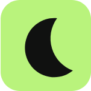

<div align="center">
  
  <h1>NightShift</h1>
  <p><strong>Your window to the web, after dark.</strong></p>
  <p>A self-hosted browser with proxied browsing, tabs, cloaking, and interactive entertainment.</p>
</div>

NightShift uses [Scramjet](https://github.com/MercuryWorkshop/scramjet) for browser traffic and [Wisp](https://github.com/MercuryWorkshop/wisp-js) for WebSocket transport. For production installs, use the [NightShift-proxy repository](https://github.com/NightShift-Network/NightShift-proxy), which contains the generated distribution. This repository, [NightShift-source](https://github.com/NightShift-Network/NightShift-source), contains the readable source for development and contributions.

The two repositories serve different purposes: the source stays readable for development, while the publisher minifies HTML and CSS and obfuscates frontend JavaScript for the production distribution. These transformations make the deployed files less directly readable to web filters that may try and block the proxy while keeping the source code open.

## Deploy on a VPS

The supported VPS installer is `setup.sh`. It targets Debian and Ubuntu and configures Docker, Nginx, HTTPS, and certificate renewal.

You need a domain pointed at the VPS and inbound TCP ports 80 and 443 open. Clone the proxy distribution repository on the VPS:

```sh
git clone https://github.com/NightShift-Network/NightShift-proxy.git
cd NightShift-proxy
sudo ./setup.sh
```

The installer prompts for the domain and email. Or provide them directly (multiple hostnames can be space separated):

```sh
sudo ./setup.sh --domain nightshift.example.com www.example.com --email you@example.com
```

The container binds to `127.0.0.1:3005` by default. Choose another loopback port with `--port PORT`.

### Manage the VPS instance

```sh
sudo ./setup.sh --start
sudo ./setup.sh --stop
sudo ./setup.sh --restart
sudo ./setup.sh --logs
sudo ./setup.sh --update
```

`--update` fast-forwards the checkout and rebuilds the container; it requires a clean Git working tree. To remove the container and Nginx site, run `sudo ./setup.sh --remove`. Add `--delete-certificate` to remove its Let's Encrypt certificate too.

### Plugins

Plugin stores are trusted Git repositories installed beside the checkout in `NightShift-data/plugins/` and mounted read-only in the container. Add stores with `sudo ./setup.sh --plugins` or `sudo ./setup.sh --plugin-url GIT_URL`; list them with `sudo ./setup.sh --plugins list` and remove one with `sudo ./setup.sh --remove-plugin STORE_NAME`.

Each indexed store has a root `plugin.json` listing direct child plugin folders. Each plugin folder contains its own `plugin.json` and assets. Plugins run in the NightShift page with its browser permissions, so install only stores you trust.

## Develop from source

Use these instructions only if you want to work on NightShift. Production users should install from [NightShift-proxy](https://github.com/NightShift-Network/NightShift-proxy).

Requirements: Node.js, npm, and network access for package installation and outbound Wisp connections.

```sh
git clone https://github.com/NightShift-Network/NightShift-source.git
cd NightShift-source
npm install
npm start
```

Open `http://localhost:3000`. Set `PORT` to use another port, for example `PORT=8080 npm start`. For remote access, use HTTPS and configure WebSocket upgrades for `/wisp/`; restrict access or add authentication before making an instance public.

### Run in the background with PM2

PM2 keeps NightShift running and can restore it after a reboot:

```sh
npm install -g pm2
PORT=3000 pm2 start server.js --name nightshift
pm2 save
pm2 startup
```

Run the platform-specific command printed by `pm2 startup`, then run `pm2 save` again. Manage the process with `pm2 status`, `pm2 logs nightshift`, `pm2 stop nightshift`, or `pm2 restart nightshift`.

### Expose it with Cloudflare Tunnel

Install `cloudflared` on the host, create a named tunnel, and configure its public hostname to route to `http://localhost:3000` (or the port selected with `PORT`). Cloudflare Tunnel supports NightShift's `/wisp/` WebSocket connection. See Cloudflare's [tunnel routing guide](https://developers.cloudflare.com/tunnel/concepts/routing/) and [WebSocket FAQ](https://developers.cloudflare.com/cloudflare-one/faq/cloudflare-tunnels-faq/).

## Features

- Multi-tab browsing, keyboard shortcuts, history, bookmarks, and quick switcher
- Epoxy and libcurl transports with per-site preferences
- Internal `nightshift://` pages, settings, diagnostics, and plugin support
- Cloaking options and a separate interactive entertainment catalog
- Local import and export for browser settings and bookmarks

Site compatibility varies, and some destinations restrict proxy traffic or depend on browser features that are difficult to proxy.

## Source and distribution

Make changes in this readable source repository. The publisher generates the distribution by obfuscating frontend JavaScript and minifying HTML and CSS. Do not edit generated files by hand.

To publish, commit source changes on `main`, set `PROXY_REPO_TOKEN` in an ignored local `.env` file with Contents read/write access to `NightShift-proxy`, then run:

```sh
./publish.sh
```

To build locally without publishing:

```sh
npm run build:proxy -- /path/to/output
```

The generated `SOURCE_COMMIT.txt` records the source revision used for the build.
